  

  
  
  
  
  

  

##  About me

- 🤖 AI-focused Python developer with **1.5+ years** building LLM-powered products
- 🔭 At **[Desklog](https://desklog.io)** I built **agentic AI in production**: an autonomous coding agent on the Claude API, MCP servers for Claude & ChatGPT, and an in-app AI agent that answers data questions and takes actions from chat
- 🧪 Working on **a new agentic AI project in Python** (coming soon)
- 🌱 Learning **system design, microservices architecture and scalable backend patterns**
- 💬 Ask me about **AI agents, MCP, the Claude API, RAG & LangGraph, Django and FastAPI**
- 🤝 Open to **AI / LLM engineering and full-stack roles**, freelance AI & Python work, and **relocation, including the GCC**
- 📍 Kannur, Kerala, India
- ⚡ Fun fact: **I enjoy breaking complex systems just to understand how they work**

 

##  What I've built

**🏢 Software Engineer · Infinite Open Source Solutions (Desklog)** · 2026

- 🤖 **Autonomous AI coding agent**: a FastAPI microservice on the Claude API that picks up Desklog tasks and writes the code end to end
- 🔌 **MCP servers** for Desklog and its CRM, so Claude and ChatGPT (including their web apps) can act on product data
- 💬 **In-app agentic AI chat** with MCP tool calling: answers questions from live data ("who is absent today?", "who worked the most?") and runs actions from plain-English commands
- 📊 **Claude Code & OpenAI Codex plugin** that tracks developers' AI usage and reports it to Desklog
- 🎨 Designed and built a **modern UI for the entire Desklog app** (Laravel Blade), plus Slack, Google Chat and Google Calendar integrations, on a multi-tenant SaaS used worldwide

**🎓 Full-Stack Python Developer Intern · Bridgeon Solutions** · 2025 – 2026

- REST APIs with Django, DRF and FastAPI; Celery + RabbitMQ jobs; Redis caching; React frontends; Docker deployments on AWS with Nginx and CI/CD

**🏋️ FitAI: AI-powered fitness & nutrition platform** · [frontend](https://github.com/adwaidhmp/FitAi-Frontend-) · [backend](https://github.com/adwaidhmp/FitAi-Backend-)

- Role-based microservices (Admin, Trainer, User) with Django, DRF, JWT, Google OAuth and OTP
- AI-generated weekly diet and workout plans; Razorpay subscriptions renewed via Celery Beat, SQS and Lambda
- Real-time trainer booking, chat and video calls with Django Channels, WebSockets and WebRTC
- **Hybrid AI knowledge assistant**: FastAPI with intent and safety classifiers, RAG (LangChain, ChromaDB) and LangGraph. The LLM is called only after the ML and retrieval checks pass, to prevent hallucinations

##  Tech stack

  <b>AI & Agents</b> 
  
  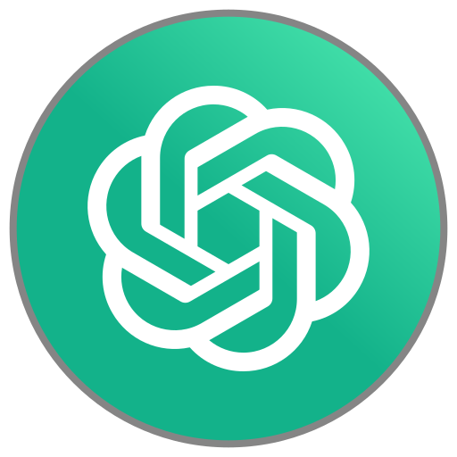
   MCP servers · AI agents · LangChain · LangGraph · RAG · ChromaDB · Claude Code & Codex plugins

  <b>Backend</b> 
  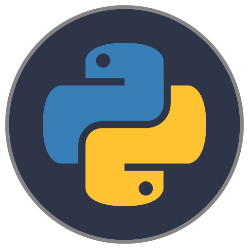
  
  
  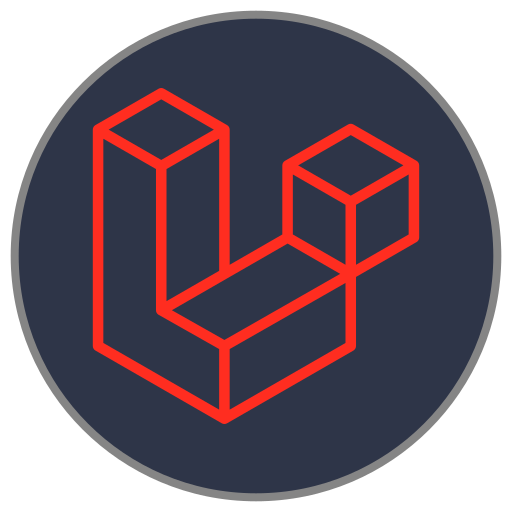
  
  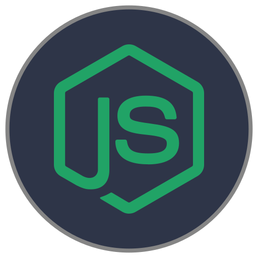
  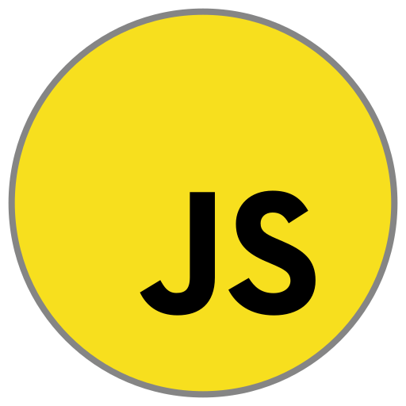
   DRF · REST APIs · JWT · OAuth · Role-based access · Microservices · Celery · RabbitMQ

  <b>Data, realtime & frontend</b> 
  
  
  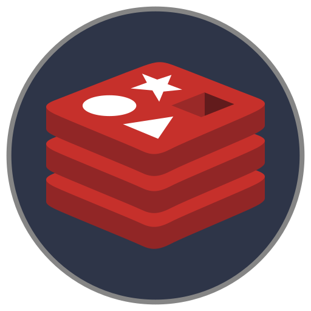
  
  
  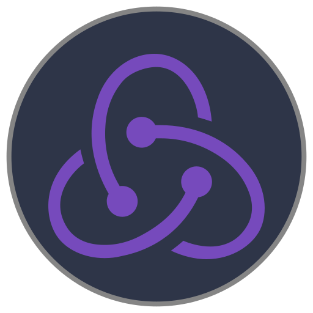
  
   SQLite · Django Channels · WebRTC

  <b>DevOps, cloud & tools</b> 
  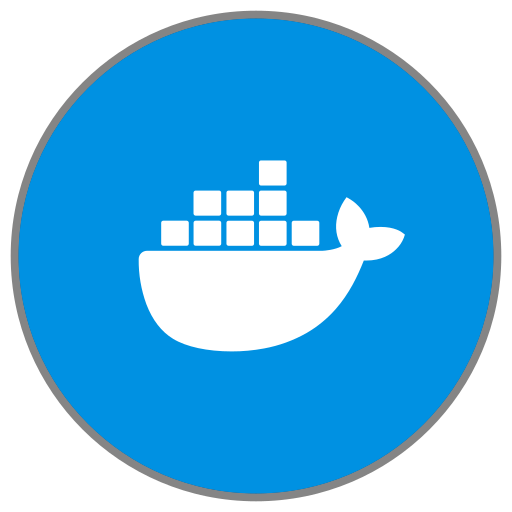
  
  
  
  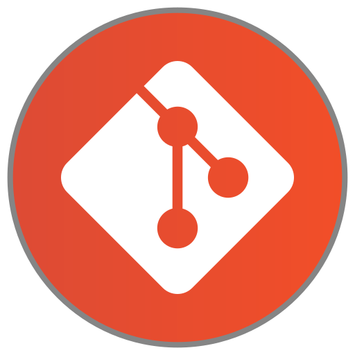
  
  
  
   Nginx · Gunicorn · PM2 · CI/CD · System design: load balancing, caching, rate limiting, CDN, message queues

##  GitHub analytics

  <picture>
    <source media="(prefers-color-scheme: dark)" srcset="https://raw.githubusercontent.com/adwaidhmp/adwaidhmp/output/heatmap-dark.svg" />
    <source media="(prefers-color-scheme: light)" srcset="https://raw.githubusercontent.com/adwaidhmp/adwaidhmp/output/heatmap-light.svg" />
    
  </picture>

  
  

  
  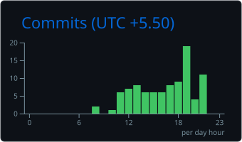

  <picture>
    <source media="(prefers-color-scheme: dark)" srcset="https://raw.githubusercontent.com/adwaidhmp/adwaidhmp/output/github-snake-dark.svg" />
    <source media="(prefers-color-scheme: light)" srcset="https://raw.githubusercontent.com/adwaidhmp/adwaidhmp/output/github-snake.svg" />
    
  </picture>

Icons by <a href="https://github.com/YuheshPandian/ICONIC">ICONIC</a> · GIFs from <a href="https://github.com/Anmol-Baranwal/Cool-GIFs-For-GitHub">Cool-GIFs-For-GitHub</a> · Heatmap by <a href="https://gitascii.com">GitAscii</a> · Stats refresh daily via GitHub Actions

